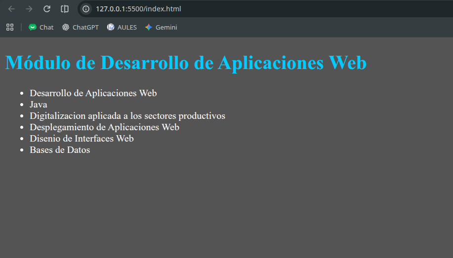

# dawAct2_3

# Práctica de Git y HTML

## Sobre esta actividad

### ¿Qué he hecho aquí?

En este repositorio he estado practicando cómo guardar mis cambios haciendo _commits_ y cómo moverme entre las diferentes **ramas** del proyecto.

Además, he preparado una pequeña página web donde hago un listado de las asignaturas de mi ciclo. Si quieres aprender a escribir textos con este formato, te recomiendo echar un vistazo a este [tutorial](https://www.markdowntutorial.com/es/).

Aquí te dejo una captura de cómo ha quedado mi página:



Y este es un pedacito del código que he utilizado para hacer la lista:

```html
<h1>Módulo de Desarrollo de Aplicaciones Web</h1>
<ul>
  <li>Desarrollo de Aplicaciones Web</li>
  <li>Java</li>
</ul>
```
